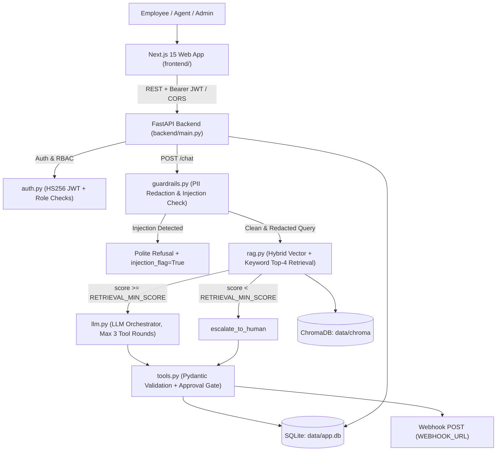

# AI-HAS: AI Helpdesk & Workflow Automation System

**AI-HAS** is an end-to-end **L1 IT Helpdesk & Workflow Automation System** built to automate first-line IT support while keeping humans in control of sensitive operations. It combines a **Next.js** multi-role web portal, a **FastAPI** backend API, **hybrid Retrieval-Augmented Generation (RAG)** backed by **ChromaDB**, **LLM function calling** with approval gates, **defense-in-depth security guardrails**, and **real-time operational analytics**.

---

## Table of Contents

1. [What the App Is About](#what-the-app-is-about)
2. [Core Capabilities](#core-capabilities)
3. [System Architecture](#system-architecture)
4. [Tech Stack](#tech-stack)
5. [User Roles & Web Portals](#user-roles--web-portals)
6. [Knowledge Base (18 IT SOPs)](#knowledge-base-18-it-sops)
7. [Database Schema & Persistence](#database-schema--persistence)
8. [Project Directory Structure](#project-directory-structure)
9. [REST API Reference](#rest-api-reference)
10. [Configuration (`.env`)](#configuration-env)
11. [Running Locally](#running-locally)
12. [Testing & Evaluation](#testing--evaluation)
13. [Deployment (Docker, Render & Vercel)](#deployment-docker-render--vercel)

---

## What the App Is About

Enterprise IT service desks are routinely bottlenecked by repetitive **Level 1 (L1)** inquiries—VPN troubleshooting, MFA resets, password resets, Outlook sync loops, Wi-Fi certificates, and software license requests—alongside high-urgency security escalations such as phishing clicks or lost corporate laptops.

**AI-HAS** addresses this with three integrated workflows:

1. **Instant Self-Service Deflection (Employee Help Center)**: Employees ask natural-language IT questions and receive grounded step-by-step instructions drawn strictly from verified Standard Operating Procedures (SOPs) with expandable SOP citations.
2. **Guided Workflow Automation with Human-in-the-Loop Safety**: When an employee needs an operational action (`create_jira_ticket`, `escalate_to_human`, `reset_password`, `request_software_access`), the AI orchestrator validates parameters against Pydantic schemas. Sensitive account/access changes (`reset_password`, `request_software_access`) triggered via live chat are gated behind an **approval ticket** so Support Agents or Administrators can approve and execute them with one click.
3. **Full Ticket Lifecycle & Admin Governance**: Support Agents triage tickets, run an AI copilot inside ticket threads, switch between public replies and staff-only internal notes, and approve tool actions. Administrators monitor deflection rates, latency, escalations, and ticket status distributions, manage the SOP vector index, configure SLA targets and guardrail toggles, and manage user RBAC roles.

---

## Core Capabilities

### 1. Hybrid RAG & Confidence-Gated Escalation (`backend/rag.py`, `backend/llm.py`)
- **Section-Aware Markdown Chunking**: Splits SOP documents by `##` headings (`chunk_size=800`, `overlap=150`) and tags every chunk with its SOP title, filename, and section name.
- **Hybrid Scoring**: Combines **ChromaDB cosine vector similarity** (`0.55` weight) with **lexical keyword overlap + header boost** (`0.45` weight) across the top `RETRIEVAL_TOP_K = 4` chunks (automatically falling back to keyword search if vector embeddings are unavailable).
- **Grounded Citations Only**: The hardened system prompt forbids answering from outside model knowledge and requires citing exact SOP titles.
- **Strict Confidence Threshold**: If no chunks match or the top chunk score falls below `RETRIEVAL_MIN_SCORE` (default `0.35`), the assistant refuses to guess, states it is unsure, and automatically calls `escalate_to_human`.
- **Ticket Playbook Matching**: `match_sop_for_ticket()` matches incoming support tickets against the SOP corpus and extracts the `## Resolution Steps` section to assist human agents.

### 2. Schema-Validated Agentic Tools & Approval Gate (`backend/tools.py`, `backend/llm.py`)
- **3-Round Tool Loop**: `answer_with_rag()` caps LLM tool-calling loops at `MAX_TOOL_ROUNDS = 3`.
- **Available Tools** (validated via Pydantic models in `backend/tools.py`):
  - `reset_password(username)` — Resets an Active Directory / SSO password (uses real AD API when `AD_API_URL`/`AD_API_TOKEN` are set, otherwise runs a deterministic mock provider).
  - `create_jira_ticket(title, description, priority, project_key)` *(and alias `create_ticket`)* — Creates a ticket in SQLite (and Jira REST API if `JIRA_API_URL`/`JIRA_API_TOKEN` are configured, otherwise mock Jira `ITSD-<id>`).
  - `escalate_to_human(reason, urgency)` — Creates an `escalated` ticket in SQLite for L2/Security human review.
  - `request_software_access(username, software_name, justification, access_level)` — Provisions licensed software access via Okta SCIM / AD (or mock SCIM provider).
- **Human-in-the-Loop Approval Gate**: When the AI attempts a sensitive tool (`reset_password` or `request_software_access`) during live chat (`require_approval_for_sensitive=True`), `execute_tool()` creates an `open` ticket titled `Approval Required: <tool_name>` instead of executing immediately. Agents or Admins approve execution via `POST /tickets/{ticket_id}/approve-action`.
- **Audit Logging & Webhooks**: Every tool validation error, approval request, and execution is persisted to `tool_audit_logs` and optionally dispatched via HTTP POST to `WEBHOOK_URL` (e.g., n8n or Make).

### 3. Defense-in-Depth Security Guardrails (`backend/guardrails.py`)
- **Pre-LLM & Pre-Log PII Redaction**: Regex scrubbing masks credit cards (`[REDACTED_CREDIT_CARD]`), national IDs/SSNs (`[REDACTED_NATIONAL_ID]`), phone numbers (`[REDACTED_PHONE]`), and email addresses (`[REDACTED_EMAIL]`) before sending user text to the LLM, before logging to `chat_logs`, and on outgoing replies.
- **Prompt Injection & Jailbreak Detection**: Detects attempts to ignore prior instructions, reveal/dump system prompts, enter "DAN / developer mode", or bypass guardrails (`INJECTION_PATTERNS`). Flagged inputs receive a polite refusal (`INJECTION_REFUSAL_MESSAGE`) and are recorded with `injection_flag=True`.
- **Hardened System Prompt**: Instructs the LLM to treat retrieved SOP chunks and user text as untrusted data and strictly prohibits disclosing internal instructions.

### 4. Authentication & Role-Based Access Control (`backend/auth.py`, `frontend/middleware.js`)
- **Signed HS256 Session JWTs**: Issued at `POST /auth/login` (7-day TTL) and enforced on protected backend endpoints via `Authorization: Bearer <token>` (with `X-Admin-Password` header support for automated admin scripts/evals).
- **3 Roles (`customer`, `agent`, `admin`)**:
  - `customer` (legacy alias `user` normalized to `customer`): Can chat, create tickets, and view **only their own** tickets (internal staff notes are filtered out).
  - `agent`: Can access all tickets, update status/priority/assignee, post public replies, add internal staff-only notes, and approve tool actions. Blocked (`HTTP 403`) from `/admin/*` UI routes and admin API endpoints.
  - `admin`: Full access across Admin Console, Agent Inbox, KB indexing/management, SLA/guardrail settings, metrics/export, and user role administration.

---

## System Architecture



---

## Tech Stack

| Layer | Technology | Details |
| --- | --- | --- |
| **Frontend** | Next.js 15, React 19, JavaScript, `lucide-react` | App Router UI in `/frontend` with role-aware middleware (`frontend/middleware.js`) |
| **Backend API** | Python 3.11, FastAPI, Uvicorn, Pydantic v2 | REST API & lifespan startup auto-indexing in `/backend/main.py` |
| **Database** | SQLAlchemy + SQLite (`data/app.db`) | Stores `users`, `tickets`, `chat_logs`, and `tool_audit_logs` |
| **Vector Store** | ChromaDB (`data/chroma`) | Cosine-distance persistent collection (`kb_sops`) |
| **LLM & Embeddings** | OpenAI Python SDK (`openai`) | Auto-selects Gemini (`gemini-3.1-flash-lite-preview` / `gemini-embedding-001`) when `OPENAI_API_KEY` starts with `AIzaSy` or `AQ.`, or OpenAI (`gpt-4o-mini` / `text-embedding-3-small`) |
| **Container / Deploy** | Docker, Docker Compose, Render, Vercel | `backend/Dockerfile`, `docker-compose.yml`, `render.yaml` |

---

## User Roles & Web Portals

After signing in at `/login`, `frontend/middleware.js` and `ModuleSwitcher.js` route users to their workspace:

### Demo Accounts (created by `init_db()` / `seed_demo_data.py`)

| Role | Username / Email | Password | Default Landing Page |
| --- | --- | --- | --- |
| **Customer (Employee)** | `marcus.vance@company.com` or `elena.rostova@company.com` | Any non-empty password (e.g., `demo123`) | `/my-tickets` |
| **Support Agent** | `jane.doe@company.com` | Any non-empty password (e.g., `demo123`) | `/agent` |
| **Administrator** | `admin` | Value of `ADMIN_PASSWORD` in `.env` (default: `changeme`) | `/admin/dashboard` |

### Portal Routes

| Route | Allowed Roles | Purpose |
| --- | --- | --- |
| `/login` | Public | Unified role-tabbed login for Customer, Support Agent, and Administrator |
| `/` | Public UI / Authenticated chat API | **Help Center & AI Chat**: Browse IT SOP categories, search/ask questions, view cited SOP snippets and tool badges |
| `/submit` | `customer` | **Submit Request**: Structured IT ticket submission form (category, priority, subject, description) |
| `/my-tickets` | `customer` | **My Tickets**: View personal ticket statuses, summaries, and customer-visible conversation threads |
| `/agent` | `agent`, `admin` | **Agent Inbox**: Filter ticket queue (`all`, `mine`, `unassigned`, `urgent`, `escalated`, `open`), view requester/SLA details, reply publicly, add internal staff notes, run AI Copilot drafts, and approve pending tool actions |
| `/admin/dashboard` | `admin` | **Analytics & KPIs**: Total chats, AI deflection rate, average latency, escalation count, ticket status breakdown, ticket table, and CSV export |
| `/admin/kb` | `admin` | **Knowledge Base**: Inspect indexed SOP documents, search by title/filename/category, and trigger ChromaDB re-indexing |
| `/admin/settings` | `admin` | **Settings & RBAC**: Configure SLA targets (minutes per priority), `retrieval_min_score`, PII/injection guardrail toggles, and update user roles |

---

## Knowledge Base (18 IT SOPs)

The `/kb` directory ships with 18 markdown Standard Operating Procedures indexed into ChromaDB:

1. `01_password_reset.md` — **SOP-01: Active Directory & SSO Password Reset**
2. `02_vpn_connection.md` — **SOP-02: Corporate VPN Connection & Troubleshooting**
3. `03_mfa_enrollment_reset.md` — **SOP-03: Multi-Factor Authentication (MFA) Enrollment & Reset**
4. `04_software_access_request.md` — **SOP-04: Standard & Licensed Software Access Requests**
5. `05_email_setup_outlook.md` — **SOP-05: Corporate Email & Microsoft Outlook Setup**
6. `06_printer_setup_troubleshooting.md` — **SOP-06: Network Printer Setup & Print Queue Troubleshooting**
7. `07_wifi_corporate_network.md` — **SOP-07: Corporate Wi-Fi (CorpNet) & Guest Network Troubleshooting**
8. `08_laptop_slow_performance.md` — **SOP-08: Slow Laptop Performance & High CPU/RAM Usage**
9. `09_shared_drive_permissions.md` — **SOP-09: Network Shared Drive & SharePoint Access**
10. `10_phishing_suspicious_email.md` — **SOP-10: Reporting Phishing & Suspicious Emails**
11. `11_account_lockout.md` — **SOP-11: Active Directory Account Lockout Resolution**
12. `12_new_hire_onboarding_it.md` — **SOP-12: New Hire IT Equipment & Account Onboarding**
13. `13_video_conferencing_teams_zoom.md` — **SOP-13: Teams & Zoom Audio, Camera, and Screen Sharing Issues**
14. `14_bitlocker_recovery_key.md` — **SOP-14: BitLocker & FileVault Disk Encryption Recovery**
15. `15_mobile_device_mdm_intune.md` — **SOP-15: Mobile Device Management (Intune MDM) Enrollment**
16. `16_docking_station_external_monitors.md` — **SOP-16: Docking Station & External Monitor Troubleshooting**
17. `17_browser_cache_sso_errors.md` — **SOP-17: Browser Cache, Cookies & SSO SAML Login Errors**
18. `18_lost_or_stolen_device.md` — **SOP-18: Lost or Stolen Corporate Laptop or Mobile Device**

---

## Database Schema & Persistence

- **SQLite (`data/app.db`)** defined in `backend/models.py`:
  - `users`: `id`, `username`, `name`, `role` (`customer` | `agent` | `admin`)
  - `tickets`: `id`, `user_id`, `title`, `description`, `priority`, `status`, `assignee`, `notes_json`, `created_at`, `updated_at`, `resolved_at`
  - `chat_logs`: `id`, `session_id`, `message` (PII-redacted), `reply`, `latency_ms`, `escalated`, `action_taken`, `injection_flag`, `created_at`
  - `tool_audit_logs`: `id`, `tool_name`, `arguments_json`, `status`, `actor`, `ticket_id`, `webhook_sent`, `result_json`, `created_at`
- **ChromaDB (`data/chroma`)**: Persistent vector collection `kb_sops` storing SOP chunk texts, embeddings, and metadata (`title`, `source`, `section`, `chunk_index`).
- **Settings File (`data/sla_settings.json`)**: Stores SLA target minutes (`urgent_minutes`, `high_minutes`, `medium_minutes`, `low_minutes`), `retrieval_min_score`, `redact_pii`, and `detect_injection`.

---

## Project Directory Structure

```text
.
├── backend/
│   ├── main.py             # FastAPI app, lifespan auto-indexing, REST routes, SLA math
│   ├── config.py           # Environment loading & Gemini/OpenAI auto-detection
│   ├── auth.py             # Login handler, HS256 JWT signing/verification, RBAC dependencies
│   ├── db.py               # SQLAlchemy engine, migrations, default users initialization
│   ├── models.py           # ORM models: User, Ticket, ToolAuditLog, ChatLog
│   ├── rag.py              # Section chunking, hybrid RAG retrieval, SOP ticket matching
│   ├── llm.py              # RAG prompting & 3-round OpenAI tool-calling loop
│   ├── tools.py            # Pydantic tool schemas, approval gate, audit log, webhook/mock providers
│   ├── guardrails.py       # Regex PII redaction, prompt injection patterns, hardened system prompt
│   ├── index_kb.py         # CLI entrypoint to rebuild ChromaDB from /kb
│   └── Dockerfile          # Container image for backend service
├── frontend/
│   ├── app/
│   │   ├── page.js         # Employee Help Center & AI Chat
│   │   ├── login/          # Unified role login page
│   │   ├── submit/         # Employee ticket submission form
│   │   ├── my-tickets/     # Customer personal ticket tracker
│   │   ├── agent/          # Support Agent inbox, AI copilot, notes, approvals
│   │   └── admin/          # Dashboard KPIs (/dashboard), KB manager (/kb), settings (/settings)
│   ├── components/         # PortalHeader, AdminSidebar, ModuleSwitcher
│   ├── lib/api.js          # Fetch client, token/cookie session helpers
│   └── middleware.js       # Route protection by auth_role & auth_token cookies
├── kb/                     # 18 IT SOP markdown files
├── eval/
│   ├── questions.json      # 25 evaluation test cases (RAG, actions, escalations, injections)
│   ├── run_eval.py         # Automated POST /chat evaluation script
│   └── stress_test.py      # Concurrent TestClient stress test suite
├── tests/
│   ├── test_guardrails.py  # 10 unit tests for PII redaction & prompt injection detection
│   └── test_rbac.py        # 7 unit tests for JWT RBAC & internal-note isolation
├── docs/
│   └── README.md           # Project documentation mirror
├── seed_demo_data.py       # Resets and seeds demo users, 12 tickets, and 18 chat logs
├── requirements.txt        # Python backend dependencies
├── docker-compose.yml      # Local Docker service definition for backend
└── render.yaml             # Render Blueprint deployment config
```

---

## REST API Reference

Protected routes require `Authorization: Bearer <jwt_token>` (admin endpoints also accept `X-Admin-Password: <ADMIN_PASSWORD>`).

| Method | Path | Access | Description |
| --- | --- | --- | --- |
| `GET` | `/health` | Public | Basic liveness check (`{"status": "ok"}`) |
| `GET` | `/api/health` | Public | Deep health check for SQLite, ChromaDB chunk count, and OpenAI/Gemini embeddings |
| `POST` | `/auth/login` | Public | Authenticate `customer`, `agent`, or `admin` and return a signed HS256 JWT |
| `POST` | `/chat` | Customer, Agent, Admin | Guardrails + Hybrid RAG + 3-round tool loop; returns `{reply, citations, action_taken, escalated, latency_ms}` |
| `POST` | `/tickets` | Customer, Agent, Admin | Create a new support ticket owned by the authenticated user |
| `GET` | `/tickets` | Customer, Agent, Admin | List tickets (customers see only their own; agents/admins see all with `?status=` and `?assignee=` filters) |
| `GET` | `/tickets/{ticket_id}` | Customer (own), Agent, Admin | Fetch ticket details (internal staff notes hidden from customers) |
| `PATCH` | `/tickets/{ticket_id}` | Agent, Admin | Update ticket `status`, `priority`, or `assignee` |
| `POST` | `/tickets/{ticket_id}/reply` | Agent, Admin | Append a public agent reply (moves `open` tickets to `in_progress`) |
| `POST` | `/tickets/{ticket_id}/notes` | Agent, Admin | Append an internal staff-only note |
| `POST` | `/tickets/{ticket_id}/approve-action` | Agent, Admin | Approve & execute a pending sensitive tool action (`reset_password`, `request_software_access`, etc.) |
| `GET` | `/metrics` | Admin | Aggregated KPIs: `total_chats`, `deflection_rate`, `avg_latency_ms`, `escalation_count`, `tickets_by_status` |
| `GET` | `/metrics/export` | Admin | Export KPIs and tickets as JSON or CSV (`?format=csv`) |
| `GET` | `/settings/sla` | Admin | Retrieve SLA minute targets, `retrieval_min_score`, and guardrail flags |
| `PUT` | `/settings/sla` | Admin | Update SLA targets, `retrieval_min_score`, and guardrail flags |
| `GET` | `/users` | Admin | List all users and their assigned roles |
| `PATCH` | `/users/{user_id}/role` | Admin | Change a user's RBAC role (`customer`, `agent`, or `admin`) |
| `GET` | `/kb/docs` | Admin | List all SOP files in `/kb` with chunk counts and sizes |
| `POST` | `/kb/upload` | Admin | Upload a UTF-8 `.md`/`.txt` SOP file and re-index ChromaDB |
| `PUT` | `/kb/docs/{filename}` | Admin | Create or overwrite an SOP file in `/kb` and re-index ChromaDB |
| `DELETE` | `/kb/docs/{filename}` | Admin | Delete an SOP file from `/kb` and re-index ChromaDB |
| `POST` | `/kb/reindex` | Admin | Re-index all `/kb` SOPs into ChromaDB |

---

## Configuration (`.env`)

Copy `.env.example` to `.env` at the repository root:

```env
OPENAI_API_KEY=<your-gemini-or-openai-api-key>
OPENAI_BASE_URL=
WEBHOOK_URL=https://httpbin.org/post
ADMIN_PASSWORD=changeme
RETRIEVAL_MIN_SCORE=0.35
```

- **Gemini Auto-Detection**: If `OPENAI_API_KEY` starts with `AIzaSy` or `AQ.` and `OPENAI_BASE_URL` is unset, `backend/config.py` automatically targets `https://generativelanguage.googleapis.com/v1beta/openai/` using `gemini-3.1-flash-lite-preview` and `gemini-embedding-001`. Otherwise it defaults to OpenAI (`gpt-4o-mini` and `text-embedding-3-small`).
- **Optional Overrides & External Integrations**: `OPENAI_CHAT_MODEL`, `OPENAI_EMBEDDING_MODEL`, `JIRA_API_URL`, `JIRA_API_TOKEN`, `AD_API_URL`, `AD_API_TOKEN`.
- **Frontend**: Set `NEXT_PUBLIC_API_URL` in `frontend/.env.local` (defaults to `http://localhost:8000`).

---

## Running Locally

### 1. Backend (FastAPI + AI Orchestrator)

```powershell
python -m venv .venv
.\.venv\Scripts\Activate.ps1
pip install -r requirements.txt

# Index the 18 markdown SOPs in /kb and seed demo users, tickets, and chat logs:
python backend/index_kb.py
python seed_demo_data.py

# Start the FastAPI server on http://localhost:8000:
uvicorn backend.main:app --reload --port 8000
```

### 2. Frontend (Next.js)

In a second terminal:

```powershell
cd frontend
npm install
npm run dev
```

Open **http://localhost:3000** in your browser, or sign in at **http://localhost:3000/login**.

---

## Testing & Evaluation

- **Unit Tests (17 tests covering guardrails and RBAC)**:
  ```powershell
  python -m unittest discover -s tests -v
  ```
- **25-Question RAG & Tool Evaluation Suite** *(requires running backend on port 8000 with a valid API key)*:
  ```powershell
  python eval/run_eval.py
  ```
- **Concurrency Stress Test**:
  ```powershell
  python eval/stress_test.py
  ```

---

## Deployment (Docker, Render & Vercel)

- **Docker Compose (Backend)**:
  ```powershell
  docker compose up --build
  ```
  Runs `seed_demo_data.py` and starts `uvicorn backend.main:app` on port `8000` with `./data` and `./kb` mounted as volumes.
- **Render (Backend Blueprint via `render.yaml`)**:
  Create a Render Blueprint from the repository, set `OPENAI_API_KEY` and `ADMIN_PASSWORD`, and Render builds `backend/Dockerfile` with `/health` checks and automatic KB indexing on boot.
- **Vercel (Frontend)**:
  Import the repository into Vercel, set **Root Directory** to `frontend`, and configure `NEXT_PUBLIC_API_URL` to your deployed backend URL.
