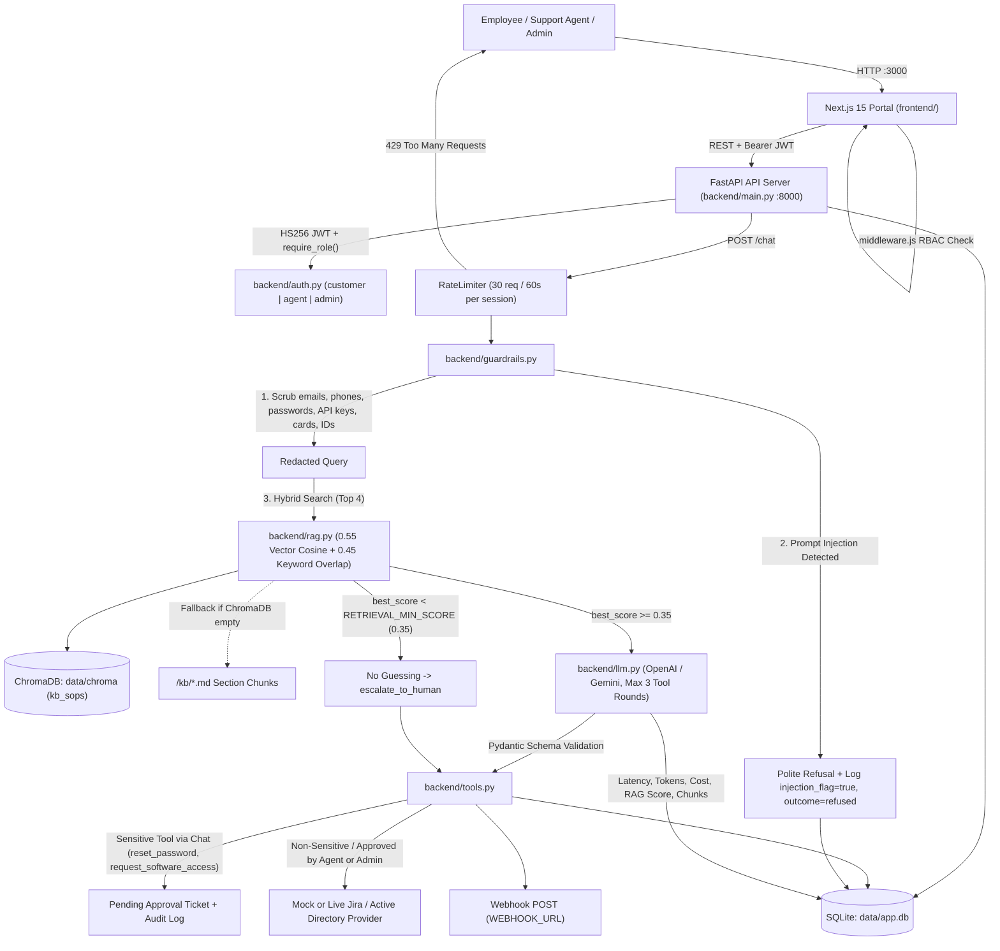

# AI-HAS System Architecture

**AI-HAS (AI Helpdesk & Workflow Automation System)** is an L1 IT Helpdesk chatbot, ticket workspace, and governance platform built with a **Next.js 15 App Router** frontend, a **FastAPI** backend, **SQLAlchemy + SQLite** persistence (`data/app.db`), **ChromaDB** vector storage (`data/chroma`), and the **OpenAI Python SDK** (`openai`) without agent frameworks.

---

## High-Level Architecture Diagram

---

## Core Architectural Subsystems

### 1. Authentication & RBAC (`backend/auth.py`, `frontend/middleware.js`)
- `POST /auth/login` verifies credentials and returns a signed HS256 JWT with `sub` (`user.id`), `username`, `name`, `role`, and `exp` (7-day TTL).
- FastAPI dependencies (`require_role(*roles)`, `require_admin`) return **HTTP `403`** when credentials are missing, invalid, or insufficient for the endpoint.
- Next.js `frontend/middleware.js` enforces matching client route isolation using `auth_token` and `auth_role` cookies:
  - `customer`: `/my-tickets`, `/submit`, `/`
  - `agent`: `/agent/*`, `/` (blocked from `/admin/*`)
  - `admin`: `/admin/*`, `/agent/*`, `/`

### 2. Defense-in-Depth Guardrails & Rate Limiting (`backend/guardrails.py`)
1. **Sliding-Window Rate Limiting**: `RateLimiter` enforces `CHAT_RATE_LIMIT_MAX` (`30` requests) per `CHAT_RATE_LIMIT_WINDOW` (`60` seconds) per session before executing retrieval or LLM calls, returning **HTTP `429`** on excess traffic.
2. **Pre-LLM & Pre-Log Redaction**: `redact_pii()` scrubs API keys (`sk-...`, `AIzaSy...`, `ghp_...`, `AKIA...`, `api_key=...`), inline passwords (`password=...`, `pwd:...`, `password is ...`), credit cards, national IDs/SSNs, phone numbers, and emails **before** calling `retrieve()`, **before** calling `answer_with_rag()`, and **before** persisting `ChatLog` rows.
3. **Prompt Injection Detection**: Matches attempts to ignore previous instructions, dump system/developer prompts, repeat prior prompt text, or enter jailbreak modes (`INJECTION_PATTERNS`). Matches are refused with `INJECTION_REFUSAL_MESSAGE` and logged with `injection_flag=True` and `outcome="refused"`.
4. **Hardened System Prompt**: Instructs the model to answer solely from provided SOP context, cite SOP titles, treat retrieved chunks and user text as untrusted data, and never disclose internal instructions.

### 3. Section-Aware Hybrid RAG (`backend/rag.py`, `backend/llm.py`)
- **Chunking**: Markdown files in `/kb/` are split along `##` headings into chunks up to 800 characters (150-character overlap) tagged with `title`, `source` (filename), `section`, and `chunk_index`.
- **Hybrid Scoring**: Combines normalized ChromaDB cosine similarity (`0.55` weight) with lexical keyword overlap + title/section header bonus (`0.45` weight) across the top `RETRIEVAL_TOP_K = 4` chunks.
- **Resilient Disk Fallback**: If ChromaDB is unindexed (such as in fresh ephemeral environments or CI) or vector embedding lookup fails, `retrieve()` falls back cleanly to lexical scoring directly over `/kb/*.md`.
- **Confidence Gating**: If the top score falls below `RETRIEVAL_MIN_SCORE` (`0.35`), `answer_with_rag()` does not call the chat LLM and escalates via `escalate_to_human`.
- **Agent Playbook Matching**: `match_sop_for_ticket()` matches active tickets against the SOP corpus (batched on `GET /tickets` via `warm_query_embeddings()`) and extracts numbered steps from `## Resolution Steps`. Resolved tickets omit `suggested_sop`.

### 4. Schema-Validated Tools, Webhooks & Human-in-the-Loop Approval (`backend/tools.py`)
- Tool inputs are validated with Pydantic v2 models (`ResetPasswordArgs`, `CreateJiraTicketArgs`, `EscalateToHumanArgs`, `RequestSoftwareAccessArgs`) before execution.
- `SENSITIVE_TOOLS = {"reset_password", "request_software_access"}` cannot execute autonomously from live customer chat when `require_approval_for_sensitive=True`: `execute_tool()` creates an `open` ticket (`Approval Required: <tool_name>`) containing the validated `pending_tool` payload, sends a `tool_approval_required` webhook, and awaits agent/admin approval at `POST /tickets/{ticket_id}/approve-action`.
- Jira (`JIRA_API_URL` / `JIRA_API_TOKEN`) and Active Directory (`AD_API_URL` / `AD_API_TOKEN`) provider functions invoke live APIs when credentials exist and otherwise return deterministic mock payloads with the same response contract.
- Every validation failure, pending approval, and execution writes a `ToolAuditLog` record in `tool_audit_logs` and fires an HTTP POST webhook if `WEBHOOK_URL` is configured.

### 5. Observability, SLA Computation & Storage Schema (`backend/models.py`, `backend/main.py`)
- **SQLite Tables (`data/app.db`)**:
  - `users`: `id`, `username`, `name`, `role`
  - `tickets`: `id`, `user_id`, `title`, `description`, `priority`, `status`, `assignee`, `notes_json`, `created_at`, `updated_at`, `resolved_at`
  - `chat_logs`: `id`, `session_id`, `message`, `reply`, `latency_ms`, `escalated`, `action_taken`, `injection_flag`, `prompt_tokens`, `completion_tokens`, `total_tokens`, `cost_usd`, `top_rag_score`, `retrieved_chunks_json`, `outcome`, `created_at`
  - `tool_audit_logs`: `id`, `tool_name`, `arguments_json`, `status`, `actor`, `ticket_id`, `webhook_sent`, `result_json`, `created_at`
- **Backend SLA Math**: `_compute_sla()` compares `created_at + priority_target_minutes` against `resolved_at` when `status == "resolved"` (freezing at `"SLA Met"` or `"SLA Breached"`) and against UTC now while open. Reopening a resolved ticket sets `resolved_at = None`.
- **Observability Metrics (`GET /metrics`)**: Computes `total_chats`, `deflection_rate`, `escalation_rate`, `mttr_minutes`, `avg_latency_ms`, `avg_rag_score`, `total_tokens`, `total_cost_usd`, `tickets_by_status`, and the 10 most recent LLM call telemetry records (`recent_llm_calls`).
